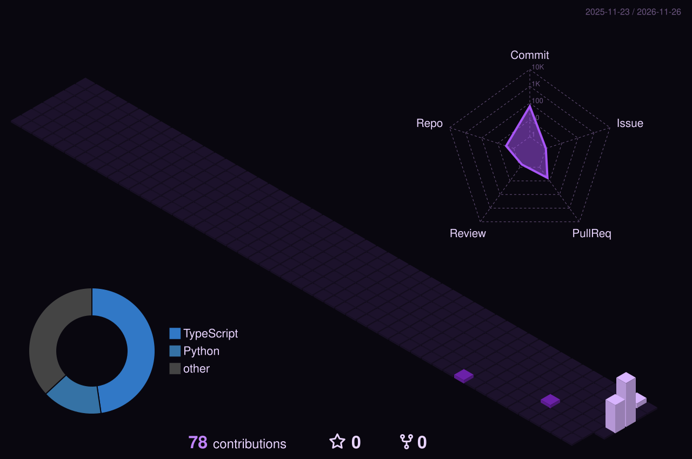

 

---

### 01 / About

Independent developer based in Vienna, Austria.

Passionate about building modern digital experiences,
exploring artificial intelligence and developing
intelligent automation solutions.

**Current focus**

- Web Development & Modern Interfaces
- AI Solutions & Workflow Automation
- Creative Engineering & AI Video Production

---

### 02 / Technology Stack

  

---

### 03 / GitHub Analytics

---

### 04 / Contribution Activity

---

### 05 / Contribution Matrix

---

`BUILD. INNOVATE. EVOLVE.`

**MrMVC**

